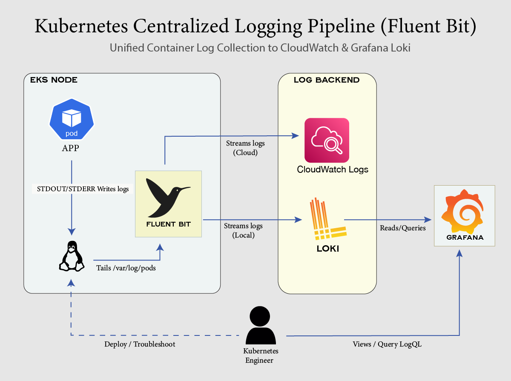

# Production-Grade Kubernetes Logging Pipeline (Fluent Bit + Loki + Grafana)

A production-aligned Kubernetes centralized logging pipeline deployed locally via OrbStack (ARM64), architected to mirror production cloud environments (AWS EKS + CloudWatch / Grafana Cloud).

## Architecture Overview



## Tech Stack & Components

* **Container Runtime:** containerd (CRI log format)
* **Log Shipper:** Fluent Bit (DaemonSet with in-cluster service account)
* **Storage Backend:** Grafana Loki (Lightweight log aggregation system)
* **Dashboard / Visualization:** Grafana (LogQL querying)
* **Target Workload:** `payment-service-simulator` emitting both structured JSON events and legacy plain-text logs.

## Repository Structure

```text
k8s-logging-pipeline/
├── README.md
├── manifests/
│   ├── 00-namespace.yaml
│   └── 01-log-generator.yaml
└── helm/
    ├── fluent-bit-values-local.yaml
    └── loki-stack-values.yaml
```

## Deployment Steps

### 1. Provision Lab Namespace & Workload

```bash
kubectl apply -f manifests/00-namespace.yaml
kubectl apply -f manifests/01-log-generator.yaml
```

### 2. Deploy Centralized Log Storage (Loki Stack)

```bash
helm repo add grafana https://grafana.github.io/helm-charts
helm repo update
helm upgrade --install loki grafana/loki-stack \
  --namespace logging-lab \
  -f helm/loki-stack-values.yaml
```

### 3. Deploy Log Shipper (Fluent Bit DaemonSet)

```bash
helm repo add fluent https://fluent.github.io/helm-charts
helm repo update
helm upgrade --install fluent-bit fluent/fluent-bit \
  --namespace logging-lab \
  -f helm/fluent-bit-values-local.yaml
```

## LogQL Validation Queries

Access Grafana via port-forwarding:

```bash
kubectl port-forward -n logging-lab svc/loki-grafana 3000:80
```

Credentials: `admin` / `admin`

* **Inspect Raw Streams:**
```logql
{job="fluent-bit"} |= "payment-service"
```

* **Filter Runtime Errors:**
```logql
{job="fluent-bit"} |= "ERROR"
```

* **Extract JSON Payloads & Filter by Attribute:**
```logql
{job="fluent-bit"} | json | amount > 250
```

## Next Phase: Production Cloud Migration (AWS EKS)

Roadmap for extending this pipeline into an enterprise-grade AWS cloud environment:

* **Terraform Infrastructure as Code (IaC):**
  * **VPC & Networking:** Multi-AZ architecture with public/private subnets, NAT gateways, and VPC endpoints.
  * **Amazon EKS Cluster:** Managed Kubernetes control plane and node groups.
  * **OIDC & IRSA (IAM Roles for Service Accounts):** Least-privilege IAM policies binding Kubernetes ServiceAccounts to AWS IAM roles without static credentials.
* **Production-Grade Log Shipping:**
  * Utilize [helm/fluent-bit-values-cloudwatch.yaml](file:///Users/mest/dev/k8s-logging-pipeline/helm/fluent-bit-values-cloudwatch.yaml) to ship container logs to **AWS CloudWatch Logs** and **Amazon OpenSearch Service**.
  * Dynamic log group creation, stream naming, and retention policies mapped per namespace and service.

