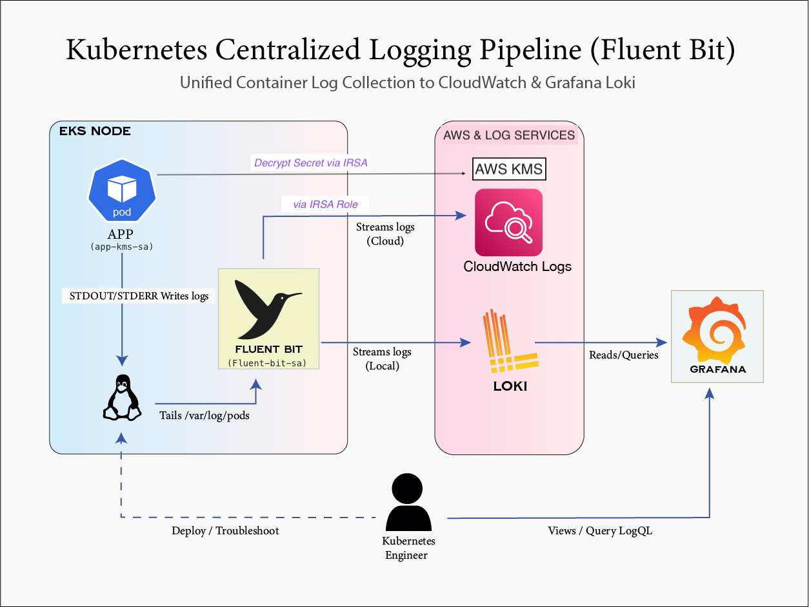
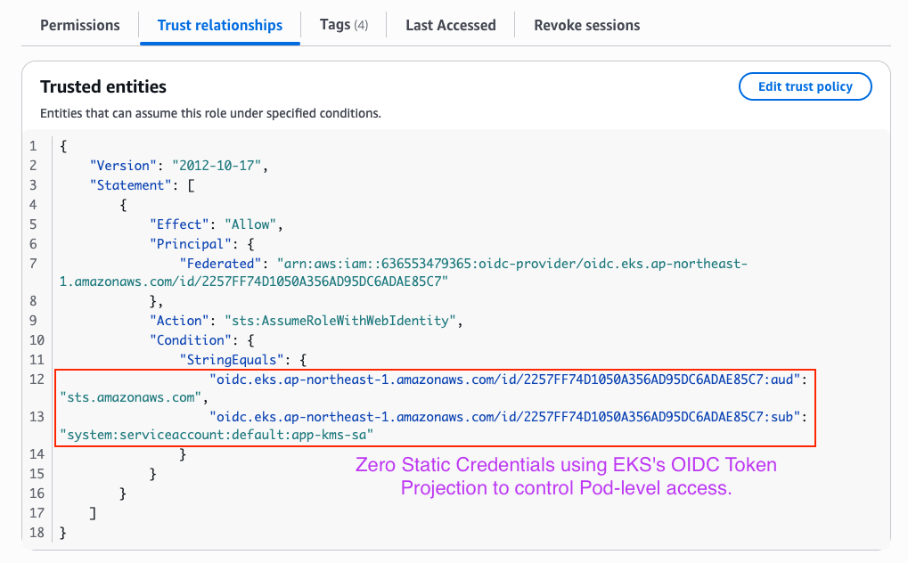
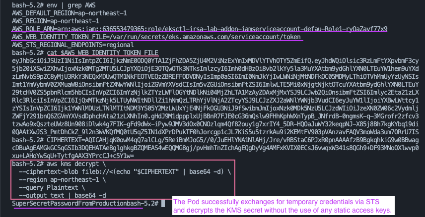
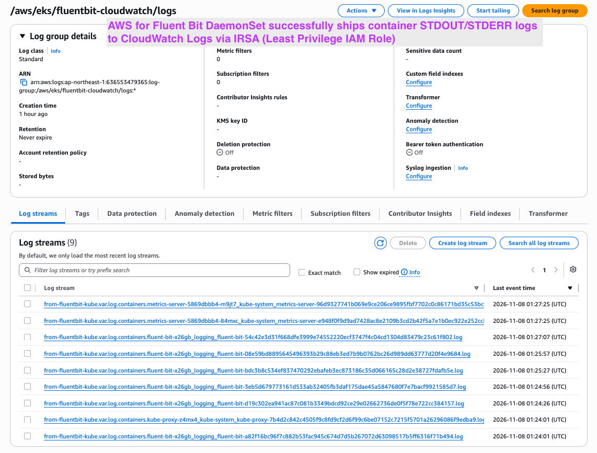

# Kubernetes Logging Pipeline

A production-focused logging solution built for Kubernetes environments, combining Fluent Bit, Loki, Grafana, and Amazon CloudWatch. This project demonstrates how to collect, centralize, and analyze logs from container workloads while applying cloud-native security controls such as AWS IRSA and KMS-based secret decryption.

This implementation is designed to be both practical for local development and relevant to enterprise Kubernetes platforms running on Amazon EKS.

## Why this project matters

Modern applications generate logs across multiple containers, nodes, and environments. Without a centralized logging pipeline, troubleshooting, monitoring, and incident response become slow and unreliable.

This project addresses that gap by creating a pipeline that:

- collects logs from Kubernetes workloads
- stores logs in a queryable backend
- supports both local and cloud-native observability
- routes logs to AWS CloudWatch for enterprise logging workflows
- applies least-privilege access using IAM Roles for Service Accounts

## Architecture overview

<div align="center">



</div>

### Core components

- Container runtime: containerd / CRI log collection
- Log shipper: Fluent Bit running as a DaemonSet
- Storage backends: Grafana Loki and Amazon CloudWatch Logs
- Security model: AWS IRSA, OIDC federation, and KMS-based decryption
- Visualizations: Grafana dashboards and CloudWatch Log Insights
- Workload: a sample application emitting both JSON and plain-text log lines

## Tech stack

- Kubernetes
- Fluent Bit
- Grafana Loki
- Grafana
- Amazon EKS
- AWS IAM / IRSA
- AWS KMS
- CloudWatch Logs

## Repository structure

```text
k8s-logging-pipeline/
├── README.md
├── app-kms-policy.json
├── fluentbit-policy.json
├── test-kms-pod.yaml
├── manifests/
│   ├── 00-namespace.yaml
│   └── 01-log-generator.yaml
├── helm/
│   ├── fluent-bit-values-cloudwatch.yaml
│   ├── fluent-bit-values-local.yaml
│   └── loki-stack-values.yaml
└── img/
    ├── logging-infra.png
    ├── eks-irsa-oidc-trust-policy.png
    ├── 02-pod-token-kms-decrypt-success.png
    └── 03-cloudwatch-log-streams-fluentbit.png
```

## Local deployment

### 1) Create the namespace and workload

```bash
kubectl apply -f manifests/00-namespace.yaml
kubectl apply -f manifests/01-log-generator.yaml
```

### 2) Deploy Loki and Grafana

```bash
helm repo add grafana https://grafana.github.io/helm-charts
helm repo update
helm upgrade --install loki grafana/loki-stack \
  --namespace logging-lab \
  -f helm/loki-stack-values.yaml
```

### 3) Deploy Fluent Bit

```bash
helm repo add fluent https://fluent.github.io/helm-charts
helm repo update
helm upgrade --install fluent-bit fluent/fluent-bit \
  --namespace logging-lab \
  -f helm/fluent-bit-values-local.yaml
```

### 4) Validate logs in Grafana

```bash
kubectl port-forward -n logging-lab svc/loki-grafana 3000:80
```

Then open Grafana in a browser and log in with:

- username: admin
- password: admin

Useful LogQL queries:

```log
{job="fluent-bit"} |= "payment-service"
```

```log
{job="fluent-bit"} |= "ERROR"
```

```log
{job="fluent-bit"} | json | amount > 250
```

## Production cloud deployment on Amazon EKS

The pipeline was also validated on Amazon EKS v1.31 with a stronger security posture for real-world enterprise environments.

### Security model

This setup uses IAM Roles for Service Accounts (IRSA) to avoid hardcoded AWS credentials.

- Workload identities are issued through the EKS OIDC provider
- Tokens are projected into pods using the Web Identity token file
- AWS STS issues short-lived credentials only when needed
- IAM policies are scoped to the minimum required actions

### Least-privilege design

- `fluent-bit-sa`: limited to CloudWatch Logs write operations such as `logs:PutLogEvents` and `logs:CreateLogStream`
- `app-kms-sa`: limited to KMS decryption actions such as `kms:Decrypt`

This pattern reduces the blast radius of a compromised workload and aligns with secure Kubernetes practices.

## What the project demonstrates

- centralized log collection from Kubernetes workloads
- dual-destination logging to both Loki and CloudWatch
- secure AWS authentication without static keys
- structured log analysis using Grafana and CloudWatch tooling
- production-oriented design patterns for deployment and troubleshooting

## Verification and Evidence

### 1. Fine-Grained OIDC Trust Policy (IRSA)
Validates that only the specific ServiceAccount (`default:app-kms-sa`) under the EKS OIDC Issuer can assume the IAM role.

<div align="center">
  
</div>

### 2. In-Pod OIDC Token Projection & KMS Decryption
Demonstrates the application pod exchanging projected STS tokens to decrypt secrets from AWS KMS without embedded AWS access keys.

<div align="center">
  
</div>

### 3. Log Ingestion to Amazon CloudWatch Logs
Confirms Fluent Bit (DaemonSet) streaming filtered container STDOUT/STDERR logs directly into the target CloudWatch Log Group (`/aws/eks/fluentbit-cloudwatch/logs`).

<div align="center">
  
</div>

## Future improvements

Planned next steps include:

- Infrastructure as Code for EKS and IAM setup using Terraform or OpenTofu
- Additional observability integrations for larger-scale environments
- Extended log routing into data warehouses or search platforms for long-term analytics
- Improved dashboards and alerting for operational visibility

## Summary

This project showcases a practical, security-conscious logging architecture for Kubernetes applications. It pairs a modern local observability workflow with a cloud-ready AWS deployment model, making it a strong example of how teams can implement reliable logging at production scale.

---

This repository is intended to demonstrate real-world engineering practices in Kubernetes operations, cloud security, and centralized observability.
